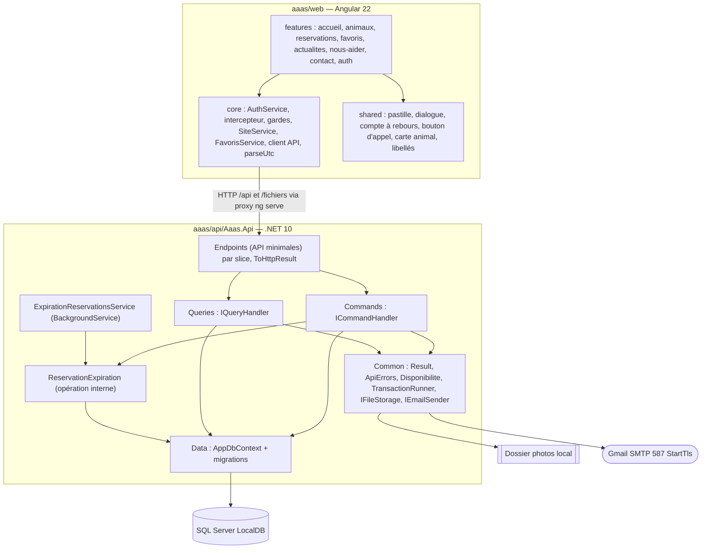
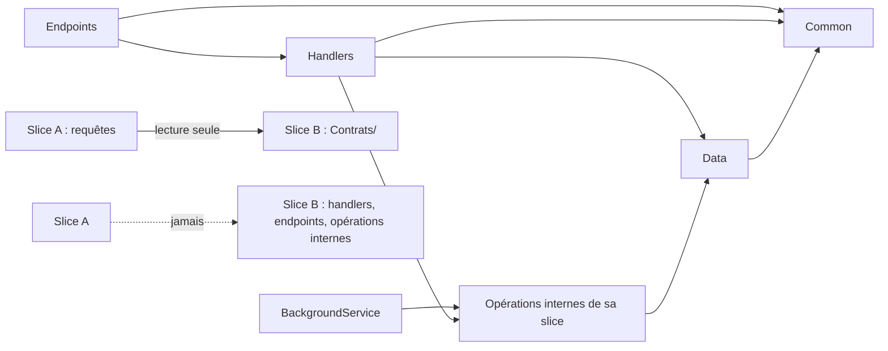
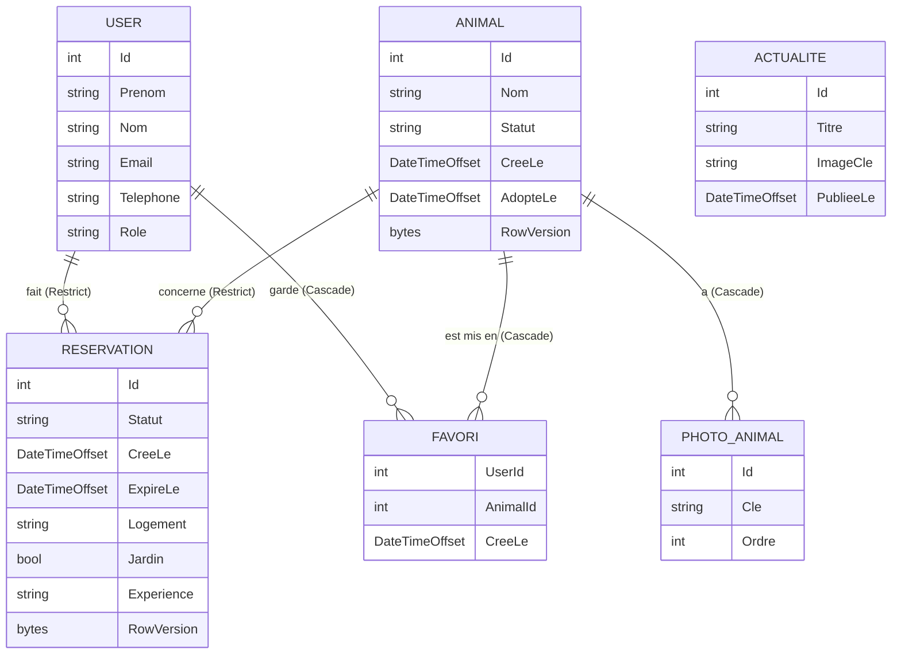
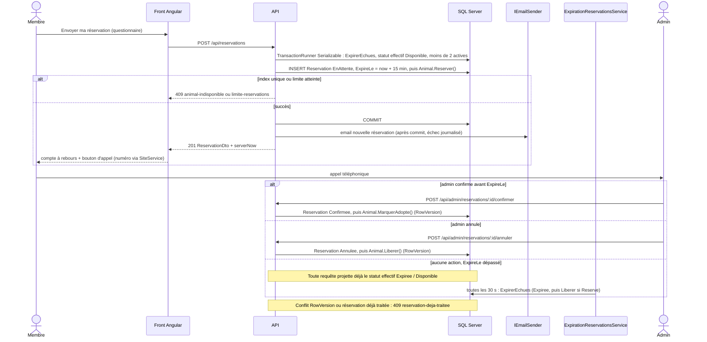
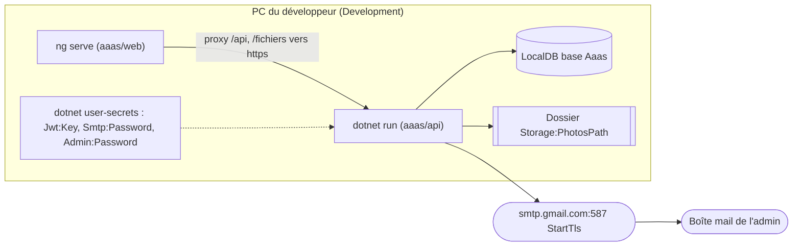

# Architecture Spine — AAAS, site d'adoption

Les tables normatives (énumérations, filtres, tris, routes API, codes de refus, glossaire des DTO, routes Angular) vivent dans le companion [`contrats-api.md`](contrats-api.md) ; elles ont la même force que les AD qui les citent.

## Design Paradigm

**Vertical slices + CQRS maison**, dans un seul projet API (+ un projet de tests). Une fonctionnalité = un dossier qui contient ses commandes, ses requêtes, ses endpoints, ses contrats de lecture et la configuration EF de ses entités. Pas de Clean Architecture multi-projets, pas de librairie de médiation. Le front Angular reprend le même découpage par fonctionnalité.

| Couche | Emplacement | Contenu |
| --- | --- | --- |
| Slices API | `aaas/api/Aaas.Api/Features/<Fonctionnalité>/` | `Commands/`, `Queries/`, `Contrats/` (DTO + projections partagés en lecture), `<Fonctionnalité>Endpoints.cs`, entités + `IEntityTypeConfiguration` |
| Transverse API | `aaas/api/Aaas.Api/Common/` | `ICommandHandler` / `IQueryHandler`, `Result<T>` + `ToHttpResult()`, `ApiErrors`, `Disponibilite/` (statut effectif), `Data/TransactionRunner`, `Json/`, `Fichiers/` (`IFileStorage`, `RegleFichier`), `IEmailSender`, `LiensFront`, `ClaimsPrincipalExtensions`, options |
| Données | `aaas/api/Aaas.Api/Data/` | `AppDbContext` unique (conventions), migrations |
| Front | `aaas/web/src/app/` | `core/` (auth, intercepteur, gardes, client API typé, états partagés), `shared/` (composants UI, libellés, pipes), `features/<fonctionnalité>/` |



## Invariants & Rules

Sens des dépendances (une flèche = « peut dépendre de ») :



### AD-1 — Vertical slices dans un seul projet API ; chaque slice possède ses entités

- **Binds:** all
- **Prevents:** deux slices qui modifient la même table chacune à sa façon ; une couche « Services » partagée ; deux projections du même concept (carte animal) ; un découpage multi-projets.
- **Rule:** Slices : `Auth` (User, seed admin), `Animaux` (Animal, PhotoAnimal), `Reservations` (Reservation, expiration), `Favoris` (Favori), `Actualites` (Actualite), `Contact` et `Site` (aucune entité). Seule la slice propriétaire écrit ses entités, avec une exception unique : les commandes de Reservations appellent les méthodes de transition d'`Animal` (AD-4) dans leur propre transaction. Une slice n'appelle jamais les handlers, endpoints ou opérations internes d'une autre slice. Une requête peut lire toute entité en lecture seule ; une slice qui expose un concept aux autres publie dans `Features/<Slice>/Contrats/` le DTO et l'expression de projection, réutilisés tels quels (`AnimalCarteDto` est le seul format de carte). `Common/` ne contient aucune règle métier propre à une slice, sauf le statut effectif (AD-5). Le compte admin est créé par `Features/Auth/SeedAdmin` au démarrage.

### AD-2 — CQRS par interfaces maison, `Result<T>`, sans MediatR [ADOPTED pour CQRS : contrainte de la spec ; s'écarte de FitClub]

- **Binds:** all (API)
- **Prevents:** deux mécanismes de dispatch (DbContext dans un endpoint, MediatR, services ad hoc) ; deux canaux d'erreur (exceptions contre valeurs de retour).
- **Rule:** Chaque cas d'usage est un `ICommandHandler<TCommand, Result<T>>` ou un `IQueryHandler<TQuery, Result<T>>` enregistré en DI (scoped) et appelé directement par l'endpoint. Aucun endpoint ne touche `AppDbContext` (FitClub le fait ; AAAS non). `Result<T>` (`Common/`) : `Ok(valeur)`, `NotFound()`, `Conflict(code)`, `Invalid(errors)`, `Forbidden()`. Un refus métier n'est jamais une exception. Les endpoints convertissent uniquement par `result.ToHttpResult()` (unique, `Common/`). Pas de MediatR ni d'autre librairie de médiation ou de pipeline.

### AD-3 — Les requêtes lisent en DTO, seules les commandes modifient l'état

- **Binds:** all (API)
- **Prevents:** une requête qui modifie l'état par effet de bord ; une entité EF sérialisée telle quelle (hachage de mot de passe, cycles, contrat qui suit le schéma).
- **Rule:** Une seule base. Les requêtes utilisent `AsNoTracking()` et projettent directement en DTO (`Select`, projections de `Contrats/`) ; aucune entité n'est renvoyée par un endpoint. Seules les commandes et `ReservationExpiration` (AD-5) écrivent. Aucune requête n'appelle de commande ni d'opération d'écriture, sans exception.

### AD-4 — Le statut d'un animal ne change que par les méthodes de l'entité Animal [ADOPTED pour le refus du forçage : décision utilisateur]

- **Binds:** CAP-4, CAP-6, CAP-7, CAP-11 ; slices Animaux et Reservations
- **Prevents:** Reservations et Animaux qui écrivent `Animal.Statut` avec des règles différentes ; un animal Disponible avec une réservation active ; un animal Réservé que rien ne libère ; une adoption conclue sans l'admin.
- **Rule:** `Animal.Statut` a un setter privé. Chaque méthode vérifie l'état source et lève `TransitionInterditeException` sinon : `Reserver()` Disponible→Reserve, `Liberer()` Reserve→Disponible, `MarquerAdopte()` Reserve→Adopte (pose `AdopteLe`). `ForcerStatut(statut)` (commande admin `POST …/statut`, AD-18) n'accepte que `Disponible` ou `Adopte`, jamais `Reserve` ; forcer `Adopte` pose `AdopteLe`, forcer `Disponible` l'efface. Elle est refusée en 409 `reservation-active` tant qu'une réservation de l'animal est active (`ReservationRules.EstActive`, AD-5). Pour libérer un animal réservé, l'admin annule la réservation. Seule `ConfirmerReservation` mène à `Adopte` par le parcours de réservation.

### AD-5 — Expiration à 15 min : ExpireLe serveur, statut effectif partagé, ménage périodique

- **Binds:** CAP-2, CAP-3, CAP-4, CAP-6, CAP-11 ; slices Reservations, Animaux, Favoris
- **Prevents:** un animal affiché Réservé ou une 3e réservation refusée alors que le délai est passé ; deux calculs de l'expiration ; une fiche et Mes réservations qui se contredisent pendant 30 s ; un délai calculé par le navigateur.
- **Rule:** À la création, la commande fixe `ExpireLe = maintenant (TimeProvider) + 15 min` ; le client n'envoie jamais de date. Le statut **effectif** est calculé par des prédicats uniques dans `Common/Disponibilite/` (sans dépendance de slice, traduisibles en SQL) : `ReservationRules.EstActive(now)` (`EnAttente` et `ExpireLe > now`), `ReservationRules.StatutEffectif(now)` (`EnAttente` échue → `Expiree`), `AnimalRules.StatutEffectif(now)` (`Reserve` sans réservation active → `Disponible`). Toute requête qui expose un statut projette le statut effectif ; les filtres et compteurs l'utilisent aussi ; le fil ne transporte que lui. La persistance passe par une seule opération interne `ReservationExpiration.ExpirerEchues(db, now)` (slice Reservations) : elle marque `Expiree` et appelle `Liberer()` seulement si l'animal est `Reserve` ; elle n'ouvre pas de transaction et n'appelle pas `SaveChanges` (l'appelant possède la transaction). Elle est appelée au début de `ReserverAnimal`, `ConfirmerReservation`, `AnnulerReservation`, et par l'`ExpirationReservationsService` toutes les 30 s (via `TransactionRunner`, AD-6). Confirmer ou annuler une réservation échue → 409 `reservation-echue`. Le front ne déduit jamais un statut de `expireLe`.

### AD-6 — Transactions et concurrence de réservation garanties par la base [ADOPTED, FitClub : Serializable, nouvel essai sur interblocage 1205, unicité 2601/2627]

- **Binds:** CAP-4, CAP-6, CAP-7 ; slices Reservations, Animaux
- **Prevents:** deux membres qui réservent le même animal à la même seconde ; une 3e réservation par double envoi ; deux façons d'ouvrir une transaction ou de réessayer.
- **Rule:** Index unique filtré sur `Reservation(AnimalId) WHERE Statut = 'EnAttente'` (nouveau : l'index FitClub n'est pas filtré). Toute commande transactionnelle passe par l'utilitaire unique `Common/Data/TransactionRunner.RunAsync(isolation, travail)` : transaction, `SaveChanges`, commit, nouvel essai borné (3) sur interblocage SQL 1205 avec `ChangeTracker.Clear()`, comme `SessionEndpoints.TryBook` de FitClub. Aucun handler n'ouvre de transaction autrement ; pas d'`EnableRetryOnFailure`. `ReserverAnimal` s'exécute en `Serializable` : `ExpirerEchues`, vérification du statut effectif `Disponible` (sinon `animal-indisponible`), vérification de moins de 2 réservations actives du membre (sinon `limite-reservations`), insertion, `Animal.Reserver()`. Violation d'unicité (2601/2627) → `animal-indisponible`.

### AD-7 — Persistance : SQL Server LocalDB, un seul AppDbContext, migrations au démarrage, suppressions fixées [ADOPTED partiel, FitClub : contexte unique, LocalDB, `Migrate()` au démarrage ; ADOPTED pour la suppression : décision utilisateur]

- **Binds:** all (API)
- **Prevents:** un provider ou un contexte EF différent d'une slice à l'autre ; un schéma modifié hors migrations ; un comportement de clé étrangère choisi par chaque slice (500 sur suppression ou historique effacé).
- **Rule:** Un seul `AppDbContext` (`Data/`) ; chaque slice déclare la configuration de ses entités dans un `IEntityTypeConfiguration<T>` de son dossier, chargé par `ApplyConfigurationsFromAssembly` (nouveau : FitClub configure tout dans `OnModelCreating`). Schéma uniquement par migrations EF Core (`Data/Migrations`), appliquées au démarrage (`Database.Migrate()`) ; une migration par story, nommée `<Slice>_<Objet>`, régénérée après rebase. Énumérations stockées en chaîne (`HasConversion<string>()`), identifiants `int` identity. Suppressions vers `Animal` et `User` fixées ici : `Favori` → `Cascade`, `PhotoAnimal` → `Cascade` (fichiers supprimés par la commande via `IFileStorage` après le commit), `Reservation` → `Restrict`. `SupprimerAnimal` est refusé en 409 `animal-a-des-reservations` dès qu'une réservation existe, quel que soit son statut.

### AD-8 — Authentification JWT, claims et rôles [ADOPTED partiel, FitClub : `PasswordHasher<User>`, HS256, garde de clé 32 octets, 60 min, `sub`, `MapInboundClaims = false`]

- **Binds:** CAP-1, CAP-4, CAP-6, CAP-7, CAP-9, CAP-10
- **Prevents:** deux façons de lire l'identité ou le rôle (`sub` contre `NameIdentifier`, `role` contre `ClaimTypes.Role`) ; une policy `Admin` qui ne voit jamais le rôle ; un compte admin créable depuis le site.
- **Rule:** `PasswordHasher<User>` d'ASP.NET Core Identity (sans Identity complet), JWT Bearer HS256, clé ≥ 32 octets vérifiée au démarrage (l'API refuse de démarrer sinon), durée 60 min. Claims émis : `sub` (id), `email`, `role` (`Membre` / `Admin`), `jti`. `MapInboundClaims = false`, `NameClaimType = "sub"`, `RoleClaimType = "role"`. Policy `Admin` = `RequireClaim("role", "Admin")`, déclarée une seule fois ; toutes les routes `/api/admin/**` sont dans un groupe qui l'exige ; les routes membre exigent `RequireAuthorization()`. L'identifiant ne se lit que par `ClaimsPrincipalExtensions.UserId()` (`Common/`) ; aucun autre code ne lit un claim. Nouveau par rapport à FitClub : rôle, policy, seed admin (`Admin:Email`, `Admin:Password`, créé ou mis à jour au démarrage), `Prenom`, `Nom`, `Telephone` obligatoire (E.164), identifiants faux → 400 `identifiants-invalides`. L'inscription publique crée toujours un `Membre`.

### AD-9 — Jeton côté client : localStorage, intercepteur, session restaurée par `/api/auth/moi`

- **Binds:** CAP-1 ; front `core/`
- **Prevents:** des appels qui envoient le jeton différemment ; un rôle relu de façon maison après rechargement ; un mauvais mot de passe qui déclenche une déconnexion ; une saisie perdue sur 401.
- **Rule:** Le jeton est stocké dans `localStorage` par un seul `AuthService` (signals) et ajouté par un seul intercepteur HTTP. Au démarrage, si un jeton existe, `AuthService` appelle `GET /api/auth/moi` avant d'activer les gardes ; le rôle vient de `UtilisateurDto`, jamais d'un décodage du jeton. Réponse 401 hors `/api/auth/*` → déconnexion locale et `/connexion?returnUrl=<page>` ; 403 ou garde Admin refusée → `/acces-refuse`. Les saisies du questionnaire et du contact sont gardées en mémoire de service jusqu'à l'envoi réussi.

### AD-10 — Format d'erreur unique de l'API [ADOPTED, FitClub `ApiErrors` : `{ error }` / `{ error, errors }`]

- **Binds:** all
- **Prevents:** un front qui analyse plusieurs formes d'erreur (ProblemDetails, corps vide) ; deux refus métier indiscernables alors que l'interface affiche deux écrans.
- **Rule:** Toute erreur, y compris 403, 404 et 500, a la forme `{ "error": "message" }` ou `{ "error": "...", "errors": { "champ": "message" } }` (400), messages en français ; les clés de `errors` sont les noms JSON camelCase du corps ou du paramètre. Les refus métier ajoutent un `code` stable, liste fermée dans `contrats-api.md` §5. Mécanismes uniques : `ToHttpResult()` (AD-2), `OnChallenge` 401 et `OnForbidden` 403 (« Cette page est réservée à l'association. ») du JwtBearer, `MapFallback` 404 pour `/api/**`, un gestionnaire d'exceptions qui renvoie 500 `{ error }` sans détail. `Results.NotFound()`, `Results.Problem()` et `ProblemDetails` sont interdits. Le front choisit l'écran selon `code`, jamais selon le texte.

### AD-11 — Temps : DateTimeOffset UTC, suffixe Z garanti, compte à rebours calé sur le serveur [ADOPTED pour TimeProvider, FitClub]

- **Binds:** CAP-4, CAP-6, CAP-8, CAP-11 ; API et front
- **Prevents:** une date relue en base sérialisée sans fuseau et interprétée en heure locale ; un compte à rebours qui diffère entre écrans ; un test non déterministe ; un sondage inventé par le front.
- **Rule:** L'heure ne se lit que par `TimeProvider` injecté (jamais `DateTime.Now` / `UtcNow`). Toutes les propriétés temporelles d'entités et de DTO sont des `DateTimeOffset` UTC (aucun `DateTime`), colonnes `datetimeoffset`, imposées par `AppDbContext.ConfigureConventions`. Un `JsonConverter<DateTimeOffset>` global (`Common/Json/`, `ConfigureHttpJsonOptions`) écrit toujours l'UTC avec `Z` ; un test d'intégration vérifie le suffixe `Z` sur `GET /api/reservations` et `GET /api/admin/reservations`. Toute réponse qui contient une réservation porte `serverNow` à la racine (collections : `{ items, serverNow }`). Le front ne parse une date que par `core/parseUtc` (rejette une date sans fuseau) ; le compte à rebours partagé calcule l'écart d'horloge depuis `serverNow`. Le front recharge la liste concernée après chaque commande admin et quand un compteur atteint 00:00 ; pas de sondage. `PublieeLe` est fixée par le serveur à la création et jamais modifiée. Affichage des dates : `LOCALE_ID` `fr-FR` et un pipe partagé.

### AD-12 — Fichiers (photos) derrière une abstraction de stockage unique [ADOPTED pour les limites : décision utilisateur]

- **Binds:** CAP-3, CAP-7, CAP-9 ; slices Animaux, Actualites
- **Prevents:** du code qui écrit sur le disque ou stocke des chemins absolus ; un nom de champ ou un ordre d'upload différent entre front et API ; deux validations de fichier ; une photo en échec qui fait échouer tout l'animal.
- **Rule:** Seul `IFileStorage` (implémentation disque, dossier `Storage:PhotosPath`) lit, écrit et supprime des fichiers et construit l'URL (`UrlPublique(cle)` → `/fichiers/<clé>`). La base ne stocke qu'une clé générée par le serveur (GUID + extension) ; `GET /fichiers/:cle` est un endpoint qui valide ce format puis lit via `IFileStorage` (pas d'`UseStaticFiles`). Upload : `multipart/form-data`, un unique champ `fichier`, une requête par fichier, pour les photos d'animal (`POST …/photos`, après l'enregistrement de l'animal) comme pour l'image d'actualité (`PUT …/image`, après création en JSON). Le front envoie les photos séquentiellement dans l'ordre de sélection ; le serveur attribue `Ordre` (max + 1, dans la transaction) ; la photo principale est celle d'`Ordre` minimal ; une suppression ne renumérote pas. Une seule `Common/Fichiers/RegleFichier` valide : JPEG, PNG ou WebP (type MIME et signature), 5 Mo max, 10 photos max par animal ; refus 400 `errors.fichier`. Le fichier est écrit avant le commit et supprimé si le commit échoue ; une suppression de fichier se fait après le commit.

### AD-13 — Emails : IEmailSender unique, MailKit vers Gmail, après le commit [ADOPTED : Gmail SMTP et politique d'échec, décisions utilisateur]

- **Binds:** CAP-5, CAP-12 ; slices Reservations, Contact
- **Prevents:** un email pour une réservation annulée par rollback ; une réservation créée mais répondue en 500 parce que le SMTP a échoué ; des paramètres SMTP dispersés.
- **Rule:** Seul `IEmailSender` envoie des emails, à `Admin:NotificationEmail`. Implémentation `Smtp` : MailKit, `smtp.gmail.com:587`, `SecureSocketOptions.StartTls`, mot de passe d'application ; implémentation `Journal` (écrit l'email dans le log), choisie par `Email:Mode`. L'email de réservation (animal, membre et téléphone, questionnaire, lien `Site:BaseUrl` + `LiensFront`) part après le commit, dans un `try/catch` avec timeout court : un échec est journalisé, la réservation reste valide et la réponse reste 201 ; pas de file de nouvel essai. Contact ne persiste rien : le message (nom, téléphone, email facultatif, texte, `pageOrigine` comme sujet) n'existe que dans l'email ; un échec d'envoi renvoie 503 `envoi-impossible` et le front conserve la saisie.

### AD-14 — Valeurs du site : une seule source, la configuration de l'API

- **Binds:** CAP-4, CAP-12 ; front (pied de page, bouton d'appel, réservation envoyée)
- **Prevents:** un numéro ou un lien de réseau social codé en dur ou renvoyé par deux endpoints.
- **Rule:** Le numéro de l'association (E.164) et les adresses Facebook et Instagram sont dans la section `Site` de la configuration de l'API, exposés uniquement par `GET /api/site`. Le front les charge une fois au démarrage dans `core/SiteService` ; aucun composant ne les écrit en dur, et la réponse de réservation ne contient pas le numéro. Les téléphones sont affichés par un seul pipe `shared/telephone.pipe` et appelés par `tel:` + E.164.

### AD-15 — Front : Angular 22 standalone, zoneless, signals, par fonctionnalité, sans NgRx

- **Binds:** all (front)
- **Prevents:** deux styles de gestion d'état ; deux états du même favori ; des écrans admin rangés à part de leur domaine ; zone.js réintroduit par habitude.
- **Rule:** Application générée par `ng new` 22 (`--style=css --ssr=false`) : standalone, zoneless (pas de zone.js), `OnPush`. État dans des services à signals ; un état partagé par plusieurs features (`AuthService`, `SiteService`, `FavorisService`) vit dans `core/` ; une feature n'importe jamais une autre feature. Routes chargées à la demande par fonctionnalité, conformes à AD-21. Les écrans admin vivent dans le dossier de leur fonctionnalité (`features/reservations/admin/…`), protégés par une garde Admin. Composants transverses (pastille de statut, dialogue de confirmation, compte à rebours, bouton d'appel, carte animal sur `AnimalCarteDto`) et `shared/libelles.ts` uniquement dans `shared/`. Tests front : Vitest (`@angular/build:unit-test`), `await fixture.whenStable()`.

### AD-16 — Interface : CSS maison à partir des jetons de DESIGN.md

- **Binds:** all (front)
- **Prevents:** des couleurs ou espacements codés en dur qui divergent du design ; une librairie de composants qui impose son propre style.
- **Rule:** Les jetons du frontmatter de `DESIGN.md` (colors, rounded, spacing, typography) sont déclarés une seule fois en variables CSS (`--color-primary`, `--rounded-md`, `--spacing-4`, `--tap-min`…) dans le style global ; les composants n'utilisent que ces variables. Pas d'Angular Material ni d'autre librairie de composants. Mode clair uniquement, mobile-first (styles de base pour 375 px, `min-width` 768 et 1024 px).

### AD-17 — Exécution locale : API et ng serve séparés, proxy Angular [ADOPTED : décision utilisateur]

- **Binds:** all ; enveloppe opérationnelle
- **Prevents:** une configuration CORS ajoutée d'un côté seulement ; des URLs d'API codées en dur ; un proxy redirigé par `UseHttpsRedirection` ; une API qui ne démarre pas sans SMTP ; des tests rendus non déterministes par le BackgroundService.
- **Rule:** Environnements : `Development` (PC du développeur) et `Testing` (tests). L'API tourne avec `dotnet run` sur le port HTTPS fixé dans `launchSettings.json` ; `ng serve` envoie `/api` et `/fichiers` vers `https://localhost:<port>` (`secure: false`). Le front appelle toujours des chemins relatifs. Pas de CORS. En `Testing` : `Email:Mode = Journal` et `Reservations:ExpirationAuto = false` (les tests appellent l'expiration directement) ; en `Development`, `Email:Mode = Smtp` exige `Smtp:Password`, sinon `Journal`.

### AD-18 — Concurrence des transitions : RowVersion, statut séparé de l'édition

- **Binds:** CAP-4, CAP-6, CAP-7 ; slices Reservations, Animaux
- **Prevents:** une réservation Confirmée et Expirée à la fois (téléphone + PC, double toucher, BackgroundService) ; un animal Adopté remis Disponible ; un formulaire admin périmé qui libère un animal réservé.
- **Rule:** `Reservation` et `Animal` portent un `RowVersion` (`IsRowVersion()`). Confirmer, annuler, expirer et forcer un statut sont des écritures concurrentes protégées par ce jeton : `DbUpdateConcurrencyException` → 409 `reservation-deja-traitee` (réservation) ou `modifie-ailleurs` (animal) ; le `BackgroundService` ignore le conflit et reprend au cycle suivant. Confirmer ou annuler une réservation dont le statut effectif est `Expiree` → 409 `reservation-echue` ; `Confirmee` ou `Annulee` → 409 `reservation-deja-traitee`. `PUT /api/admin/animaux/:id` ne porte jamais de statut ; forcer un statut est la commande dédiée `POST /api/admin/animaux/:id/statut { statut, statutAttendu }`, refusée en 409 `modifie-ailleurs` si le statut effectif diffère de `statutAttendu`. Sur 409, le front recharge la carte ou le formulaire.

### AD-19 — Énumérations, filtres et tris : un seul catalogue

- **Binds:** CAP-2, CAP-3, CAP-4, CAP-6, CAP-7, CAP-11 ; API et front
- **Prevents:** des enums sérialisées en entiers par une slice et en chaîne par une autre ; deux noms de paramètre de filtre ; une sémantique « Oui ou À voir » différente ; des tris différents d'un écran à l'autre.
- **Rule:** Les énumérations, leurs valeurs exactes, les paramètres de filtre du catalogue et les tris sont ceux de `contrats-api.md` §1–§3. Sérialisation en chaîne par le convertisseur global `EnumEnChaineConverter` (`Common/Json/`, `ConfigureHttpJsonOptions`), jamais par attribut : nom C# exact, même casse ; valeur inconnue, entier ou casse différente → 400 (décision 2026-10-14 : `JsonStringEnumConverter` ignore la casse en lecture). Les libellés affichés vivent uniquement dans `shared/libelles.ts`.

### AD-20 — Contrat de routes API

- **Binds:** all (API et `core/` client API)
- **Prevents:** deux formes de route ou de verbe pour la même action (favoris, réserver, adoptés, actions admin) ; des codes de retour différents.
- **Rule:** La table de `contrats-api.md` §4 est normative : toute route absente est interdite tant que la table n'est pas mise à jour. Actions d'état : `POST` + verbe à l'infinitif, 200 avec la ressource ; création 201 avec la ressource ; suppression 204 ; favoris `PUT`/`DELETE` idempotents en 204. Routes en minuscules sans accent ; admin sous `/api/admin/<fonctionnalité>`. La réservation d'un autre membre renvoie 404.

### AD-21 — Routes front et liens construits par l'API

- **Binds:** all (front), CAP-5 (lien de l'email)
- **Prevents:** un lien d'email qui tombe sur une 404 front ; une garde qui redirige vers une route que la feature auth n'écoute pas.
- **Rule:** La table de `contrats-api.md` §7 est normative pour les routes Angular. Le paramètre de retour après connexion s'appelle `returnUrl`. Les liens construits par l'API ne viennent que des constantes de `Common/LiensFront.cs`, alignées sur cette table.

### AD-22 — Forme JSON : glossaire unique, DTO plats, collections enveloppées

- **Binds:** all (API et front)
- **Prevents:** des noms de propriété différents entre API et front (`nom` contre `prenom`, `createdAt` contre `creeLe`) ; des objets imbriqués d'un côté et plats de l'autre ; des tableaux nus qui casseront à l'ajout d'une pagination.
- **Rule:** Le glossaire de `contrats-api.md` §6 est la seule source des noms de DTO et de propriétés ; les interfaces TypeScript de `core/api/` le reprennent à l'identique. JSON camelCase, français sans accent, DTO plats (seule imbrication : un DTO de `Contrats/`). Toute collection : `{ items, serverNow }`, même vide. Texte facultatif : trimé, vide → `null`. URLs de fichiers relatives dans les DTO.

## Consistency Conventions

| Concern | Convention |
| --- | --- |
| Langue du code | Types et propriétés métier en français sans accent (`Animal`, `Reservation`, `ReserverAnimal`, `CreeLe`, `ExpireLe`) ; seuls `Id` et les suffixes techniques sont en anglais (`Command`, `Query`, `Handler`, `Endpoints`, `Dto`). Textes affichés et messages d'erreur en français, vouvoiement. |
| Fichiers | Un fichier par commande ou requête : `Features/Reservations/Commands/ReserverAnimal.cs` contient `ReserverAnimalCommand` + son handler. Front : `kebab-case` (`compte-a-rebours.component.ts`). |
| Statuts affichés | Libellés exacts de `state-machines.md` via `shared/libelles.ts` ; pastilles invariables. |
| Confirmation des actions | Toute annulation ou suppression admin passe par le dialogue de confirmation partagé ; l'API n'exige pas de second appel. |
| Configuration et secrets | Options typées liées par section et validées au démarrage (`ValidateOnStart`, comme `JwtOptions` de FitClub). Secrets uniquement dans `dotnet user-secrets` (`UserSecretsId` dans le csproj) : `Jwt:Key`, `Smtp:Password`, `Admin:Password` ; jamais dans `appsettings*.json` (écart volontaire : FitClub garde une clé `DEV-ONLY` dans `appsettings.Development.json`). Les tests fournissent leurs secrets par configuration en mémoire. |
| Journalisation | `ILogger` standard ; aucun mot de passe ni jeton journalisé ; échecs SMTP journalisés en `Error`. |
| Tests backend | xUnit v3 + `WebApplicationFactory` sur une base LocalDB jetable par exécution (modèle `FitClubFactory`, environnement `Testing`, config en mémoire). Nouveau : `FakeTimeProvider` injecté dans la factory pour l'expiration. |
| Tests front | Vitest (défaut de `ng new` 22). |

## Stack

| Name | Version |
| --- | --- |
| .NET SDK | 10.0.401 (SDK du poste, sans `global.json` ; décision 2026-10-14) |
| .NET runtime / ASP.NET Core (API minimales, net10.0) | 10.0.12 (décision 2026-10-14) |
| Microsoft.EntityFrameworkCore.SqlServer / .Design | 10.0.12 (décision 2026-10-14) |
| Microsoft.AspNetCore.Authentication.JwtBearer | 10.0.12 (décision 2026-10-14) |
| MailKit (+ MimeKit) | 4.18.1 (jamais en dessous de 4.16) |
| SQL Server LocalDB | 2025 (17.0), instance `(localdb)\MSSQLLocalDB` |
| xunit.v3 | 4.0.2 |
| xunit.runner.visualstudio | 3.1.5 (épinglé au scaffold) |
| Microsoft.AspNetCore.Mvc.Testing | 10.0.12 (décision 2026-10-14) |
| Microsoft.Extensions.TimeProvider.Testing | 10.11.0 (épinglé au scaffold) |
| Angular (CLI, @angular/build) | 22.2.x (CLI 22.2.2) |
| TypeScript | 6.0.x (imposé par Angular 22) |
| Node.js | ^22.22.3 ou ^24.15.0 (poste : 24.15.0) |
| Vitest | version fournie par `ng new` 22.2.x |
| Gmail SMTP | smtp.gmail.com:587 StartTls, mot de passe d'application, compte Gmail personnel avec validation en 2 étapes |

## Structural Seed

```text
aaas/
  api/
    Aaas.sln
    Aaas.Api/
      Program.cs
      Common/            # ICommandHandler, IQueryHandler, Result, ApiErrors, Disponibilite/, Data/TransactionRunner,
                         # Json/, Fichiers/ (IFileStorage, RegleFichier), IEmailSender, LiensFront, ClaimsPrincipalExtensions
      Data/              # AppDbContext (ConfigureConventions), Migrations/
      Features/
        Auth/            # User, inscription, connexion, moi, SeedAdmin
        Animaux/         # Animal, PhotoAnimal, Contrats/ (AnimalCarteDto), catalogue, fiche, adoptés, CRUD admin, statut, photos
        Reservations/    # Reservation, réserver, mes réservations, admin, ReservationExpiration, ExpirationReservationsService
        Favoris/         # Favori, PUT, DELETE, lister
        Actualites/      # Actualite, liste publique, CRUD admin, image
        Contact/         # envoi de message (email seulement)
        Site/            # GET /api/site
    Aaas.Api.Tests/      # xunit.v3 + WebApplicationFactory + FakeTimeProvider
  web/
    proxy.conf.json      # /api et /fichiers -> https://localhost:<port>, secure false
    src/
      styles.css         # variables CSS issues de DESIGN.md
      app/
        core/            # AuthService, intercepteur, gardes, SiteService, FavorisService, api/ (interfaces DTO), parseUtc
        shared/          # pastille, dialogue, compte à rebours, bouton d'appel, carte animal, libelles.ts, pipes
        features/        # accueil, animaux, reservations, favoris, actualites, nous-aider, contact, auth
```

Entités principales (noms et relations ; le code possède le détail) :



Réservation et expiration :



Environnement et secrets (seul environnement d'exécution : poste du développeur) :



Clés de configuration non secrètes (`appsettings.json`) : `ConnectionStrings:Aaas`, `Jwt:Issuer`, `Jwt:Audience`, `Jwt:ExpiresMinutes`, `Email:Mode`, `Smtp:Host`, `Smtp:Port`, `Smtp:User`, `Admin:Email`, `Admin:NotificationEmail`, `Site:Telephone`, `Site:Facebook`, `Site:Instagram`, `Site:BaseUrl`, `Storage:PhotosPath`, `Reservations:ExpirationAuto`.

## Capability → Architecture Map

| Capability / Area | Lives in | Governed by |
| --- | --- | --- |
| CAP-1 Comptes Membre / Admin | `Features/Auth`, `core/` (AuthService, intercepteur, gardes) | AD-8, AD-9, AD-10, AD-21 |
| CAP-2 Catalogue filtré | `Features/Animaux/Queries`, `features/animaux` | AD-3, AD-5, AD-19, AD-22 |
| CAP-3 Fiche animal | `Features/Animaux/Queries`, `features/animaux` | AD-3, AD-5, AD-12, AD-22 |
| CAP-4 Réservation + 15 min | `Features/Reservations`, `shared/` compte à rebours | AD-4, AD-5, AD-6, AD-10, AD-11, AD-14, AD-18 |
| CAP-5 Email nouvelle réservation | `Features/Reservations`, `Common/IEmailSender` | AD-13, AD-21 |
| CAP-6 Admin réservations | `Features/Reservations` (admin), `features/reservations/admin` | AD-4, AD-5, AD-8, AD-11, AD-18 |
| CAP-7 CRUD animaux + photos + statut | `Features/Animaux` (admin), `features/animaux/admin` | AD-4, AD-7, AD-8, AD-12, AD-18 |
| CAP-8 Actualités publiques | `Features/Actualites/Queries`, `features/actualites`, accueil | AD-3, AD-11, AD-19 |
| CAP-9 CRUD actualités | `Features/Actualites` (admin) | AD-8, AD-11, AD-12 |
| CAP-10 Favoris | `Features/Favoris`, `core/FavorisService`, `features/favoris` | AD-1, AD-8, AD-15, AD-20 |
| CAP-11 Ils ont trouvé une famille | `Features/Animaux/Queries` | AD-4, AD-5, AD-19 |
| CAP-12 Pages Nous aider + Contact | `Features/Contact`, `Features/Site`, `features/nous-aider`, `features/contact` | AD-13, AD-14 |

## Deferred

- **Hébergement et mise en ligne** (serveur, nom de domaine, HTTPS de production, base hors LocalDB) : à décider quand l'association veut publier le site.
- **Stockage cloud des photos** : une nouvelle implémentation d'`IFileStorage` suffira ; à revoir avec l'hébergement.
- **Jeton en cookie httpOnly + protection CSRF** : à trancher avant toute mise en ligne publique (remplacerait AD-9).
- **Renouvellement et révocation du jeton** : à revoir avec le passage en cookie.
- **CI/CD** : à revoir quand un dépôt partagé ou un hébergement existe.
- **Sauvegardes de la base et des photos** : à décider avec l'hébergement, avant la saisie de vraies données d'adoption.
- **Monitoring et alertes** (dont échecs d'envoi d'email) : à revoir à la mise en ligne.
- **File de nouvel essai des emails** : à revoir si les échecs journalisés deviennent fréquents.
- **Révocation du mot de passe d'application Gmail** (un changement de mot de passe du compte Google casse l'envoi) : procédure à écrire à la mise en ligne.
- **Mise à jour en temps réel** (SignalR ou sondage de la liste admin) : à revoir si le rechargement après action et à 00:00 ne suffit pas.
- **Redimensionnement et compression des photos** : à revoir si le poids des pages pose problème sur mobile.
- **Limitation de débit et anti-spam du formulaire de contact** : à revoir à la mise en ligne.
- **Pagination** (catalogue, listes admin) : au-delà d'une centaine d'éléments ; forme imposée le jour venu : `?page=1&taille=20`, réponse `{ items, total, serverNow }` (compatible AD-22).
- **Limite par défaut des listes admin Annulées / Expirées** (par exemple 30 derniers jours) : à revoir quand ces listes deviennent longues.
- **Versions des paquets de test annexes** (`Microsoft.NET.Test.Sdk`, `coverlet.collector`) : à épingler au scaffold, alignées sur xunit.v3.
- **Concurrence optimiste sur l'édition complète d'un animal ou d'une actualité** (lost update entre deux onglets admin hors statut) : à revoir si plusieurs admins existent un jour.
- **RGPD et mentions légales** : non-goal de cette version (spec).

## Open Questions

- **Valeurs de configuration à fournir** (EXPERIENCE) : numéro de l'association (`Site:Telephone`), adresse Facebook (`Site:Facebook`), adresse Instagram (`Site:Instagram`), email de notification de l'admin (`Admin:NotificationEmail`).
