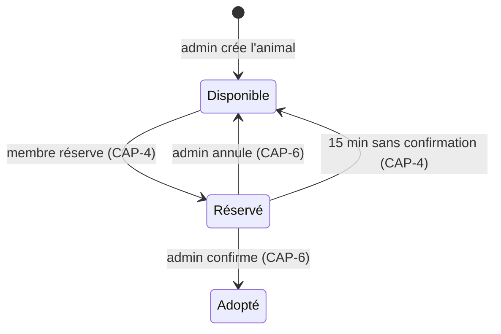
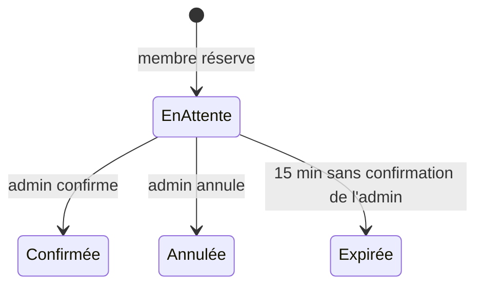

# Machines à états

## Statut d'un animal

- Une seule réservation active par animal : réserver un animal non Disponible est refusé.
- Au plus 2 réservations En attente par membre : une troisième est refusée.
- L'admin peut aussi forcer le statut depuis le CRUD animaux (CAP-7).
- Adopté : retiré du catalogue (CAP-2), affiché dans « Ils ont trouvé une famille » (CAP-11).

## Statut d'une réservation

- Le délai court à partir de la création de la réservation ; le membre doit appeler l'admin, qui confirme pendant l'appel.
